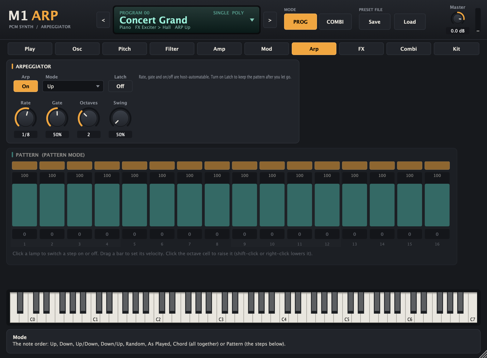

# M1 ARP

A late-80s style PCM workstation synthesizer with an added arpeggiator, built
with JUCE. It models the voice, combination and effects behaviour of a classic
16-voice PCM keyboard from published specifications, and adds a step
arpeggiator the hardware never had. Builds as an **Audio Unit**, **VST3** and
**Standalone** app for macOS (universal arm64 + x86_64), aimed first at
Ableton Live.

This is a clean-room implementation: no factory PCM, presets, panel artwork or
manual text are included. Every multisample in the built-in bank is synthesised
in code.



## Features

- **Programs** in Single (16 voices), Double (8 voices, two oscillators with
  interval, detune and delayed start) or Drums mode.
- **100 multisound slots and 44 drum sounds**, synthesised at load time: band-
  limited zones per octave, seamless loops, attack transients and detuned
  ensembles. Your own recordings can replace any slot (see below).
- **VDF / VDA**: gentle non-resonant low-pass and amp, each with a four-segment
  envelope, velocity and keyboard tracking. Pitch EG, pitch and filter MGs,
  aftertouch and mod-wheel routing.
- **Two effect processors** (33 types: halls, rooms, early reflections, delays,
  chorus, flanger, phaser, tremolo, EQ, overdrive, exciter, ensemble, rotary
  and delay combinations), serial or parallel.
- **Combinations**: Single, Layer, Split, Velocity Switch and an 8-part Multi
  sharing one 16-slot voice pool.
- **Arpeggiator**: Up, Down, Up/Down, Down/Up, Random, As Played, Chord and a
  16-step Pattern mode with per-step on/off, octave and velocity. Locks to the
  host grid when the transport runs and free-runs when it stops. Swing, gate,
  octave range, latch, and per-timbre arps in Multi.
- **Editor** with ten pages (Play, Osc, Pitch, Filter, Amp, Mod, Arp, FX,
  Combi, Kit), live envelope graphs and an on-screen keyboard that shows the
  notes after the arp. Point at any control and the **Info View** strip along
  the bottom says what it does and what its values mean, like Live's own.
- 24 factory programs, 8 combinations and 4 General-MIDI-layout drum kits.
  Presets save and load as `.m1arp` files.

## Building

Requires Xcode and a JUCE 8 checkout at `~/Development/JUCE`.

```bash
~/Development/JUCE/extras/Projucer/Builds/MacOSX/build/Release/Projucer.app/Contents/MacOS/Projucer --resave M1Arp.jucer
```

```bash
cd Builds/MacOSX && xcodebuild -project M1Arp.xcodeproj -target "M1Arp - All" -configuration Release build
```

The build copies the AU and VST3 into `~/Library/Audio/Plug-Ins`. Rescan
plug-ins in your host after building.

The first launch synthesises the sample bank (about a second in Release) and
caches it in `~/Library/Caches/com.alistairrutherford.m1arp/`, so later
launches load straight away.

## Tests

```bash
Tests/run_tests.sh
```

```bash
Tests/run_integration.sh
```

`run_tests.sh` covers envelopes, filter, voices, drums, arpeggiator, effects,
combinations and state. `run_integration.sh` needs a Release build first and
renders audio through the real processor.

## Your own samples

`Tools/pack_bank.py` packs a directory of `zones.json` files and WAVs into a
`bank.m1bk`:

```bash
Tools/pack_bank.py my-samples/ ~/Library/Audio/Presets/"Alistair Rutherford"/"M1 ARP"/bank.m1bk
```

Its slots replace the built-in ones. A zone's `tuneCents` is a correction: a
sample recorded 3 cents sharp of its root stores `-3`.

## Documentation

[PLAN.md](PLAN.md) describes the design: signal path, parameter curves,
arpeggiator timing, effects, combinations, file formats and test plan.

## License

The M1 ARP source code is licensed under Apache 2.0. See [LICENSE](LICENSE).

The plugin is built with [JUCE](https://juce.com), which is dual-licensed under
the [AGPLv3](https://www.gnu.org/licenses/agpl-3.0.en.html) and the commercial
[JUCE 8 licence](https://juce.com/legal/juce-8-licence/). Apache 2.0 code can be
combined with AGPLv3 code, but a built AU, VST3 or Standalone binary includes
JUCE and so is also covered by JUCE's terms. If you distribute a build, either
distribute it under the AGPLv3 with its complete source, or hold a JUCE licence
that covers your use.

The Steinberg VST3 SDK (MIT) and Apple AudioUnitSDK (Apache 2.0) that come with
JUCE place no further restrictions on builds.
